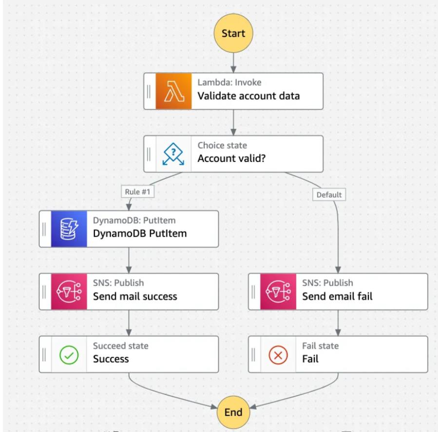

# Step functions

- Serverless orchestration service
- Coordinates multiple distributed services, serverless functions, and human approvals into a visual workflow [state machine]
- Instead of writing custom retry loops, sleep timers, error handling, and coordination logic inside lambda code, step fun manages the state declaratively

- Builds serverless visual workflow to orchestrate lambda functoins
- Sequence, parallel, conditions, timeouts, error handling...
- Can integrate with EC2, ECS, on-premises servers, API gateway, SQS queue, etc
  - also, human approval feature

## State and workflow definitions

- Worfklows are defined using ASL [Amazon States Language], a json-based schema
- Visualizable as flowcharts in AWS console

