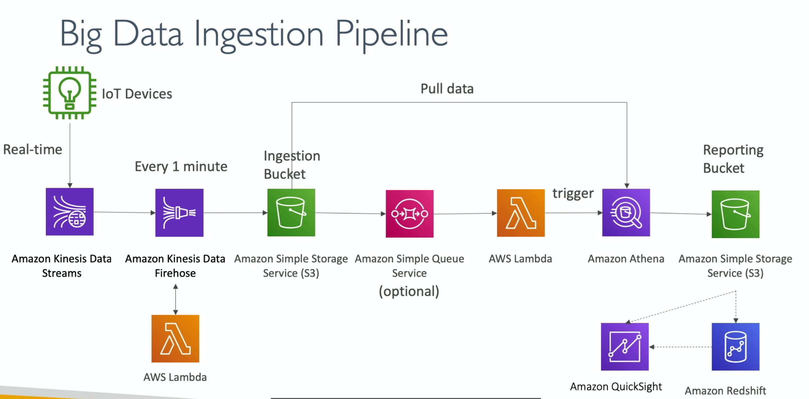

# Data Ingestion Pipeline

- We want:
  - the ingestion pipeline to be serverless
  - to collect data in real time
  - to transform the data
  - to query the transformed data using SQL
  - the reports created using the queries to be in s3
  - to load the data into a warehouse and create dashboards

- Continuouly/periodically collecting raw data from disparate sources [mobile apps, IoT devices, relational dbs, clickstreams, server logs] and security landing it into cloud for storage/analysis

- 2 core ingestion methodologies
  - batch ingestion
  - streaming [real-time] ingestion

## Ingestion architectural patterns

| Ingestion type      | how it works                                                                     | Primary AWS Tools                                         | Use case                                                                              |
| ------------------- | -------------------------------------------------------------------------------- | --------------------------------------------------------- | ------------------------------------------------------------------------------------- |
| Batch ingestion     | Data is collected and bundled, then transferred at scheduled intervals           | AWS database migration service; glue/step functions; MWAA | nightly db dumps; CRM data sync; end-of-day financial reporting                       |
| Streaming ingestion | Data is generated continuously and piped into the cloud instantly event-by-event | Kinesis data stream; Data firehose; MSK                   | real-time user clickstream tracking, IoT telemetry; application logs; fraud detection |
| Micro batching      | Hybrid approach of gathering data into small temporary windows [ex: 1-5min]      | Firehose [buffering]; glue streaming jobs                 | near-real-time dashboard metrics where absolute sub-second delivery isn't mandatory   |

## Complete end-to-end big data pipeline

```
[ 1. SOURCES ]          [ 2. INGESTION ]         [ 3. STORAGE (LAKE) ]    [ 4. PROCESSING / ETL ]   [ 5. CONSUMPTION ]

  • Relational DBs   ──►  • AWS DMS (Batch)    ──►  • Amazon S3          ──►  • AWS Glue (Spark)   ──►  • Amazon Athena (SQL)
  • IoT Sensors      ──►  • Amazon MSK (Stream)──►   (Raw landing zone)       (Clean & Parquet)    ──►  • Amazon Redshift (DW)
  • App Clickstreams ──►  • Kinesis Firehose   ──►                                               ──►  • Amazon QuickSight (BI)
```

### Batch and stream hybrid big data ingestion and processing pipeline



1. Real-ingestion and buffering
   - IoT devices: telemetry, sensors data, logs
     - data generated in real time
   - Kinesis data streams
     - real-time message bus
     - captures the incoming high-velocity data stream with low latency
   - Kinesis data firehose and lambda
     - firehose reads the stream and buffers the data
       - firehose helps with data delivery to s3 in near real-time
     - AWS lambda can transform, clean, massage the data before it's written
       - lambda can help firehose with data transformations

2. Raw landing and decoupling
   - s3 [ingestion bucket]
     - firehose flushes the batched files into an S3 "raw" bucket
   - SQS [optional]
   - if decoupled event-driven archi is desired, s3 event notifcations can push messages to SQS queue

3. Transformation and querying
   - Lambda & Athena
     - lambda triggers athena or processes files directly
     - Athena acts as serverless SQL engine, querying the raw data sitting in s3 without managing servers
   - S3 [reporting bucket]
     - once Athena processes, flattens, or aggregates the raw data, the refined results are saved back into a clean, structured reporting bucket
     - often, the structure bucket stores data as columnar files like Apache Parquet

4. Warehousing and visualization
   - Redshift
     - processed data from the reporting bucket can be loaded into Redshift for heavy, high-performance data warehousing and complex business intelligence joins
   - QuickSight
     - connects directly to reporting s3 bucket or redshift to render interactive dashboards, charts and BI
